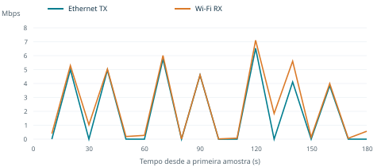
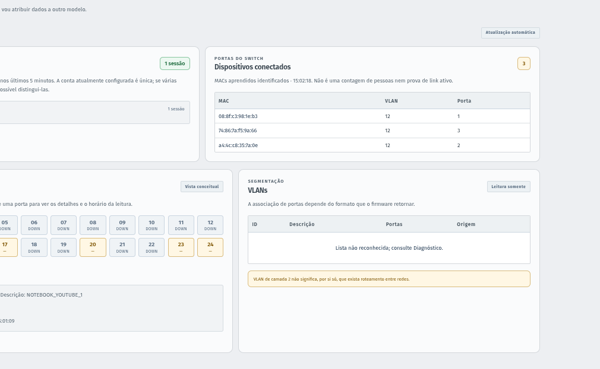
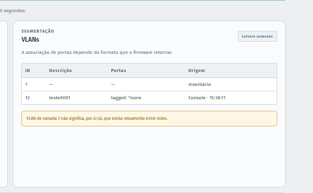
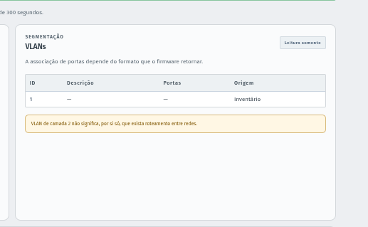

# Catálogo técnico do teste
Huawei Quidway S3900 • VLAN 12 • 16 de novembro de 2026

**Sessão:** 20261116_S3900_VLAN12_3notebooks. Consolidação das evidências existentes e verificação complementar de leitura no Fedora, via Remote Desktop Commander. Horários deste relatório: America/Sao_Paulo, UTC-03; os arquivos brutos mantêm UTC quando aplicável.

## Resultado do ensaio

A VLAN 12 e suas portas 1, 2 e 3 foram confirmadas nas leituras armazenadas. O Fedora apresentou Ethernet compartilhada em 10.42.0.1/24, saída Wi-Fi e serviço DHCP para os clientes. Na verificação complementar, os dois clientes e 8.8.8.8 responderam a 20 de 20 pings cada.

**YouTube simultâneo:** confirmado pelo operador nesta conversa: “Sim, os dois reproduziram simultaneamente”. A confirmação é humana; as amostras de tráfego não identificam o aplicativo e não há captura simultânea dos dois players.

| Evidência | Cobertura | Resultado |
| --- | --- | --- |
| Dashboard JSONL | 15:56:08 a 16:02:03 | 52 registros; 3 com timeout serial |
| Contadores do Fedora | 15:56:39 a 15:59:39 | 19 amostras; 18 intervalos de ~10 s |
| Consultas complementares | 16:03:06 a 16:03:44 | IPs, rotas, DHCP, DNS, ping e contadores |
| Prints da plataforma | Históricos, da conversa anterior | 3 capturas originais incluídas |

## Parecer

**Funcionamento observado na janela curta, com ressalvas de observabilidade.** Há evidência de conectividade local, acesso externo do Fedora, distribuição DHCP e tráfego compatível com o cenário. A reprodução simultânea é sustentada pelo relato do operador. Não foi certificado funcionamento sem interrupções, isolamento entre VLANs, desempenho máximo ou estabilidade prolongada.

A perda anterior de 1/4 pacotes (25%) para 10.42.0.75 permanece registrada como histórico narrado. A nova rodada apresentou 0/20 perdidos. Não combinar as duas rodadas em uma taxa única.

## Preservação do ambiente

Nenhuma configuração do switch ou da rede foi alterada nesta etapa; não houve publicação no GitHub. Credenciais, cookies, chaves e configuração integral do switch não integram o pacote. As consultas novas foram de leitura, além de sondas ICMP curtas e resolução de nome.

# Topologia, endereços e DHCP
Identidades correlacionadas entre dashboard, Fedora e journal

**Caminho do cenário:** rede externa / gateway 192.168.1.1 → Wi-Fi do Fedora 192.168.1.100 → Ethernet 10.42.0.1 → porta 2 do S3900 → VLAN 12 → portas 1 e 3 → clientes. As setas descrevem a topologia informada e corroborada; não substituem rastreamento ponta a ponta.

| Elemento | IPv4 / interface | MAC | Porta |
| --- | --- | --- | --- |
| Fedora LAN | 10.42.0.1/24 enp0s31f6 | a4:4c:c8:35:7a:0e | 2 |
| Cliente 1 Aspire-A315-34 | 10.42.0.75 | 08:8f:c3:98:1e:b3 | 1 |
| Cliente 2 lrcufupc | 10.42.0.155 | 74:86:7a:f5:9a:66 | 3 |
| Fedora Wi-Fi | 192.168.1.100/24 wlp2s0 | 52:68:d6:a0:62:01 MAC em uso | — |

A MAC LAN do Fedora foi lida diretamente da interface. Sua ligação à porta 2 é corroborada pela descrição FEDORA_INTERNET, pelo cenário e pelo print histórico E08; a MAC não aparece no recorte JSONL da sessão. MACs dos clientes e respectivas portas aparecem em E01 e são correlacionadas aos IPs por E03 e E04.

## Compartilhamento e rota

Perfil S3900-INTERNET: ipv4.method=shared, endereço 10.42.0.1/24. Rota padrão via 192.168.1.1 em wlp2s0; rede 10.42.0.0/24 em enp0s31f6. Às 16:03:06, net.ipv4.ip_forward=0, mas forwarding de enp0s31f6 e wlp2s0=1. Esses valores são registrados tal como retornaram; a leitura isolada do valor global não permite concluir interrupção do encaminhamento. Regras NAT não foram inspecionadas.

## Servidor DHCP e concessões

dnsmasq PID 114478 ativo, escutando em 10.42.0.1, com faixa 10.42.0.10–10.42.0.254 e duração configurada de 3.600 s. O arquivo de concessões exigiu senha administrativa e não foi lido. O journal do NetworkManager forneceu evidências DHCPACK:

| Horário | Evento / cliente | MAC |
| --- | --- | --- |
| 15:41:58 | DHCPACK 10.42.0.155 • lrcufupc | 74:86:7a:f5:9a:66 |
| 15:47:37 | DHCPACK 10.42.0.75 • Aspire-A315-34 | 08:8f:c3:98:1e:b3 |
| 16:00:31 | DISCOVER/OFFER/REQUEST/ACK para .75 | 08:8f:c3:98:1e:b3 |

Os eventos de 15:41 e 15:47 antecedem a captura de tráfego; o ciclo das 16:00:31 está dentro da sessão JSONL. Os nomes são os anunciados no DHCP; a distribuição Linux dos clientes não foi inspecionada nesta etapa.

# Conectividade e resumo de perdas
Sondas originadas no Fedora • 16:03:06 a 16:03:12

Método: ping IPv4 numérico, 20 solicitações por destino, intervalo de 0,3 s, espera de resposta de 1 s, payload de 56 bytes. As três rodadas foram executadas em paralelo. O retorno bruto está em E03.

| Destino | TX / RX | Perda | RTT médio | Mín. / máx. |
| --- | --- | --- | --- | --- |
| 10.42.0.75 | 20 / 20 | 0% | 0,505 ms | 0,315 / 0,697 ms |
| 10.42.0.155 | 20 / 20 | 0% | 0,496 ms | 0,321 / 0,697 ms |
| 8.8.8.8 | 20 / 20 | 0% | 39,444 ms | 36,256 / 53,708 ms |

A consulta getent ahostsv4 youtube.com retornou 142.251.128.110 no Fedora às 16:03:06. Isso comprova resolução de nome pelo mecanismo local naquele instante; não mede reprodução de vídeo nem comprova a rota externa de cada cliente.

## Ocorrências que precisam permanecer no catálogo

| Quando | Ocorrência | Interpretação |
| --- | --- | --- |
| Etapa anterior | Cliente .75: 1 de 4 perdido (25%) | Relato da conversa anterior; sem saída bruta e sem horário exato da sonda. |
| 15:59:49 | Vizinho .75 em FAILED | Falha de resolução de vizinho naquele instante; não é uma rodada de ping. |
| 16:00:31 | Novo ciclo DHCP do cliente .75 | Evidência de aquisição do endereço; causa e duração da mudança não determinadas. |
| 16:03:06 | Vizinho .75 REACHABLE | Conectividade de vizinhança restabelecida nas consultas. |
| 16:03:06–12 | Ambos os clientes: 20/20 | Sem perda de ICMP nesta janela curta. |

## Contadores do Fedora às 16:03:44

| Interface | Erros RX / TX | Descartes RX / TX | Escopo |
| --- | --- | --- | --- |
| enp0s31f6 | 0 / 0 | 0 / 120 | Acumulados da interface |
| wlp2s0 | 0 / 0 | 0 / 740 | Acumulados da interface |

Os descartes acumulados não possuem uma linha de base no início da sessão; não é possível atribuir 120 ou 740 descartes a este teste. E02 registra somente bytes, não pacotes/erros. Não foram capturados contadores CRC ou descartes do switch. Os 3 timeouts seriais são falhas de coleta, não perdas IP.

# Tráfego medido no Fedora
19 amostras • 18 intervalos • 180,016746 segundos

Janela de 15:56:39,476 a 15:59:39,493. Associação comprovada pelo script E06: eth=enp0s31f6 e wifi=wlp2s0. RX/TX são vistos do Fedora. MB e Mbps usam base decimal.

| Fluxo | Volume (MB) | Média (Mbps) | Pico de intervalo (Mbps) |
| --- | --- | --- | --- |
| Ethernet RX | 0,898203 | 0,039916 | 0,148727 |
| Ethernet TX | 43,508292 | 1,933522 | 6,532143 |
| Wi-Fi RX | 52,862817 | 2,349240 | 7,105454 |
| Wi-Fi TX | 5,937720 | 0,263874 | 1,464491 |

Cálculo da média: 8 × (contador final − inicial) / duração entre timestamps UTC. As taxas de intervalo preservam os valores do CSV original, calculados pelo relógio monotônico; diferenças pequenas de arredondamento/timestamp são esperadas. A primeira linha é a linha de base, sem taxa.

Não houve redução de contadores. Dois intervalos Ethernet tiveram RX e TX zero (fins em 15:58:19 e 15:58:29); isso não comprova falha ou travamento. Wi-Fi inclui tráfego do próprio Fedora e do acesso remoto. Não somar volumes Ethernet e Wi-Fi como dados úteis distintos nem atribuir todo o volume ao YouTube.

# Switch e qualidade das leituras
Quidway 3900-SI 28-Port • Version 3.10(CN), RELEASE 0002

E01 contém 52 registros válidos ao longo de 354,639 s; 49 horários distintos de snapshot. O catálogo estava programado para 15:56:06–16:02:06. O último registro é de 16:02:03. O amostrador E06 registrou as 19 amostras previstas em três minutos; às 16:03:44 não havia processo correspondente ativo. Não foi reiniciado.

## VLAN 12

Três leituras individuais, às 15:58:11, 15:59:45 e 16:01:19, registraram portas 1/2/3 untagged, nenhuma tagged e membership_partial=false. Descrição observada predominante: teste0001; uma leitura contém uma aspa extra. As três portas apresentam modo access e PVID 12.

| Porta / descrição | Última leitura da porta | Última evidência do link | RX / TX final (Mbps) |
| --- | --- | --- | --- |
| 1 • NOTEBOOK_YOUTUBE_1 | 16:01:50 | UP • 15:58:17 | 0,019808 / 1,212608 |
| 2 • FEDORA_INTERNET | 16:01:57 | UP • 16:01:57 | 2,840120 / 0,080384 |
| 3 • NOTEBOOK_YOUTUBE_2 | 16:02:03 | UP • 16:01:38 | 0,042680 / 2,013680 |

**Valores finais do cache, com idades diferentes.** O código de atualização do painel (E12) mantém campos antigos quando a resposta nova está incompleta. observed_at da porta pode avançar sem atualizar RX, TX ou PVID. link_observed_at tem horário próprio; não foi observado DOWN, mas isso não comprova link ininterrupto. As descrições exibiram caracteres divergentes em várias leituras.

## Falhas de coleta

| Horário | Consulta que expirou | Efeito registrado |
| --- | --- | --- |
| 15:57:03 | Ethernet1/0/3 | stale=true; cache preservado |
| 15:58:32 | Ethernet1/0/2 | stale=true; cache preservado |
| 16:00:00 | Ethernet1/0/1 | stale=true; cache preservado |

São 3/52 registros (5,77%) marcados stale com erro; esse quociente descreve registros, não a taxa de falha de todas as consultas ou perda de pacotes. Intervalos entre registros: 4,724 a 15,132 s. Mesmo stale=false não garante que todos os campos tenham sido renovados.

As taxas do switch são convertidas pelo parser de bytes/s para bits/s a partir de “Last N seconds”. O JSONL não conserva N nem a CLI bruta; a janela exata não pode ser certificada. Não calcular média de desempenho pela repetição desses snapshots. A contagem MAC refere-se ao conjunto completo; mac_records filtra somente as portas 1/2/3.

# Print da plataforma: dispositivos
E08 • captura histórica original da conversa “Teste interface”

Esta imagem é anterior à janela de 15:56–16:02. Ela corrobora o mapeamento físico informado: 08:8f:c3:98:1e:b3 → porta 1; 74:86:7a:f5:9a:66 → porta 3; a4:4c:c8:35:7a:0e → porta 2. Os dois primeiros mapeamentos também aparecem no JSONL da sessão; o terceiro é apoiado pelo print e pela interface LAN do Fedora.

A seção VLANs da mesma imagem exibe “Lista não reconhecida; consulte Diagnóstico”. Portanto, a captura registra uma limitação histórica de apresentação do painel e não deve ser usada para concluir inexistência da VLAN 12.

Arquivo original de origem: image(20261116-180240).png. A imagem foi copiada sem edição de seu conteúdo; somente redimensionada para caber nesta página.

# Prints da plataforma: VLANs
E09 e E10 • apresentação histórica antes das leituras consolidadas

Esses prints documentam estados anteriores da interface. A evidência mais recente de associação à VLAN vem das três leituras individuais em E01, com portas 1/2/3. Não confundir a lista parcial ou o texto “tagged: none” com a ausência dos clientes.

Origens: image(20261116-183937).png e image(20261116-183236).png. Os nomes não foram usados como prova de horário. A obtenção de novos prints foi bloqueada pelo controle de permissão do navegador para a plataforma local; nenhum print atual foi obtido nesta etapa.

# Catálogo de verificações
Classificação explícita: medido, relatado e não comprovado

| ID | Verificação | Classificação / resultado |
| --- | --- | --- |
| T01 | VLAN 12 e portas 1/2/3 | COMPROVADO 3 leituras individuais; untagged 1/2/3, access/PVID 12 |
| T02 | Fedora como gateway da LAN | COMPROVADO PARCIAL 10.42.0.1/24; shared; rota externa Wi-Fi; forwarding por interface=1 |
| T03 | Associação IP/MAC cliente 1 | COMPROVADO 10.42.0.75 / 08:8f:c3:98:1e:b3 / porta 1 / VLAN 12 |
| T04 | Associação IP/MAC cliente 2 | COMPROVADO 10.42.0.155 / 74:86:7a:f5:9a:66 / porta 3 / VLAN 12 |
| T05 | DHCP dos clientes | COMPROVADO DHCPACK .155 às 15:41:58; .75 às 15:47:37 e 16:00:31 |
| T06 | Ping Fedora -> cliente 1 | COMPROVADO 20/20, 0% perda, RTT médio 0.505 ms |
| T07 | Ping Fedora -> cliente 2 | COMPROVADO 20/20, 0% perda, RTT médio 0.496 ms |
| T08 | Ping Fedora -> 8.8.8.8 | COMPROVADO 20/20, 0% perda, RTT médio 39.444 ms |
| T09 | Resolução de youtube.com no Fedora | COMPROVADO getent retornou 142.251.128.110 |
| T10 | Tráfego na Ethernet do Fedora | COMPROVADO 43.508292 MB TX em 180.016746 s |
| T11 | YouTube simultâneo nos 2 clientes | RELATADO PELO OPERADOR Usuário confirmou nesta conversa |
| T12 | Ausência de travamentos e perdas prolongadas | NÃO COMPROVADO Sem telemetria de buffer ou ensaio longo |
| T13 | Perdas/CRC do switch | NÃO MEDIDO JSONL não guarda esses contadores |
| T14 | Persistência após reinício do switch | NÃO RETESTADO Não houve reboot ou consulta de configuração salva nesta etapa |

O CSV catalogo_testes.csv complementa esta matriz com fontes e limites por item. “Comprovado” sempre se restringe à evidência e janela descritas; não equivale a homologação global do ambiente.

# Rastreabilidade e arquivos
Fontes preservadas e metodologia de consolidação

| ID | Fonte no pacote | Uso |
| --- | --- | --- |
| E01 | evidence/20261116_S3900_VLAN12_3notebooks.jsonl | VLAN, portas, MACs e qualidade |
| E02 | evidence/fedora_network_samples.csv | Bytes e taxas originais |
| E03 | evidence/readonly_checks.json | IPs, rotas, ping, DNS, shared |
| E04 | evidence/extra_checks.json | DHCP, relógio, processo e contadores |
| E05 | evidence/context_notes.json | Relato do operador e histórico |
| E06 | evidence/sampler_source.py | Método da amostragem Fedora |
| E07 | evidence/collector_source.py | Campos e regras da captura JSONL |
| E08–10 | evidence/print_01 a print_03*.png | Capturas históricas da plataforma |
| E11 | evidence/active.json | Identificação e expiração da sessão |
| E12 | evidence/parser_excerpt.txt | Parser e preservação de campos |

## Procedimento e limites de aquisição

Foram copiadas as evidências após o término da janela, calculados volumes por diferença de contadores e analisados timestamps de cada entidade. Os scripts de origem foram apenas lidos. Consultas complementares: ip address/route/neigh/link, nmcli com campos restritos, sysctl de leitura, pgrep, journalctl filtrado, timedatectl, getent e ping. Nenhuma sessão CLI nova no switch foi iniciada.

O Fedora informou Timezone=America/Sao_Paulo e NTPSynchronized=yes às 16:03:44. Não houve medição independente de desvio de relógio; não usar o relógio antigo do switch ou nomes de imagens para datar a sessão.

A tentativa de ler o arquivo de concessões com sudo não interativo exigiu senha; nenhuma senha foi solicitada ou utilizada. O DHCP foi comprovado pelos ACKs do journal. As capturas históricas foram obtidas dos anexos da conversa referenciada; o bloqueio de novos prints foi respeitado.

## Conteúdo entregue

PDF, catálogo em Markdown e JSON, CSV de testes, CSV de amostras de rede, CSV de pings, CSV de histórico das portas e pacote de evidências. Os CSVs derivados usam UTF-8 com BOM, vírgula como separador e ponto decimal; campos vazios indicam ausência de valor. As taxas são em bit/s, salvo colunas explicitamente em Mbps no relatório.

O arquivo MANIFEST_SHA256.txt registra a integridade dos itens do pacote. O pacote preserva os arquivos brutos; relatórios e CSVs derivados não substituem as fontes. A cópia persistente é armazenada sob instance/lab_tests/catalogo_20261116_S3900_VLAN12_3notebooks/ no projeto do Fedora.

Pendências para uma futura rodada: capturas simultâneas dos players com horário, resolução e duração; sondas externas iniciadas nos clientes; contadores de erros/drops no início e fim; validação de isolamento da VLAN e ensaio mais longo. Essas verificações não foram executadas nesta etapa.
